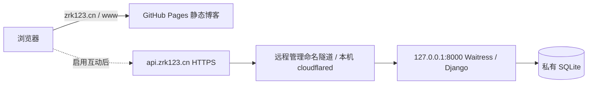

# 本机后端公网接入指南

更新：2026-10-25。本轮唯一操作路线是 **Cloudflare 控制台远程管理的命名隧道**。账号、NS/DNSSEC 与 Published application 由站主操作；本项目不读取隧道 Token、不修改系统服务或防火墙。本次新增授权允许审核后提交/push 网站源码；不代表允许修改账号控制台或隧道凭据。

## 实际状态与结构

- 静态博客：https://zrk123.cn/；www 为备用入口。GitHub Pages 始终独立提供文章、搜索、项目、图片、公式。
- API：https://api.zrk123.cn/api；健康检查准确地址为 **https://api.zrk123.cn/api/health/**，`/api` 只拼接一次。
- 本机 Waitress / Django / SQLite 已启动并核实仅监听 **127.0.0.1:8000**。
- 已有 cloudflared Windows 服务由站主安装，程序 `C:/Program Files (x86)/cloudflared/cloudflared.exe`，版本 **2026.10.3**，Windows 签名 Valid，签名方 Cloudflare, Inc.；没有重复安装或读取服务命令行。
- 公开解析器查询 NS 为 `gerardo.ns.cloudflare.com` 与 `keyla.ns.cloudflare.com`。系统缓存曾仍显示阿里云旧 NS；不能据此要求再次改 NS。
- 真实公网 health 和 CORS 曾全部通过，但连接器 readyConnections 在 **4 与 0** 之间波动，出现 1033，首次公网写入验收因此中断；18:37 恢复后完整 15 项真实公网写入检查已通过。仍需关注稳定性。
- 公网验收通过后，工作流已切换 **connected** 并完成提交/push，Actions 部署成功；production 继续保留为回退配置。实际部署结果见 API_ACCESS_RESULT.md 与最终交接。



本机睡眠、关机、断网只影响互动。主域名不指向本机，不采用双 A 记录假装容灾。

## 私有生产配置已合并

在 `blog/backend/.env` 保留既有数据路径、密钥和其他配置，先备份再合并了以下非秘密值。备份在私有 `backups/pre-access-时间/`，不要上传。

```ini
BLOG_ENV=public
BLOG_PROXY_MODE=cloudflare-tunnel
ALLOWED_HOSTS=api.zrk123.cn
CORS_ALLOWED_ORIGINS=https://zrk123.cn,https://www.zrk123.cn
REGISTRATION_OPEN=false
```

公开示例为 backend/public.env.example。DEBUG 固定 false。默认关闭新注册，**已有账号仍能正常登录**。要开放注册，站主先创建管理员、确认审核能力，再改私有配置为 true 并重启后端；不需重新构建网站，界面会读取 health 的注册开关。不提供邮件验证或找回密码的虚假入口。

生产 CORS 仅两个精确 HTTPS Origin，不含路径、末尾斜线或通配符。本地浏览器验收使用独立 8008 测试服务和独立数据目录，允许 localhost:1313；不能为预览放宽生产白名单。

## 认证、权限和客户端地址：代码核查结论

| 项目 | 实现与实际体验 |
| --- | --- |
| 八小时过期 | community/auth.py 的 ExpiringTokenAuthentication 在每次认证时比较 Token.created；超过八小时删除 Token 并返回 401，非仅界面计时 |
| 退出、停用 | logout 删除当前 Token；用户停用接口删除其 Token；DRF 基类也检查 is_active，本地直接停用同样失权 |
| 单账号登录 | 新登录轮换旧 Token，旧登录立即失效 |
| 保存位置 | community.js 仅内存保存 Token；刷新、整页跨文章、新标签页都需重新登录；当前不是 SPA，不承诺无缝登录；不改为长期 localStorage |
| 跨域认证 | fetch credentials=omit，显式 Authorization: Token；允许 authorization/content-type 预检，不依赖第三方 Cookie |
| Cookie / CSRF | DRF 只配置 ExpiringTokenAuthentication，无 SessionAuthentication。虽安装 Django admin/session 组件与 CSRF 中间件，urls.py **没有开放 /admin/、/api-auth/ 或 Cookie 登录路由**，均实测 404；现有 Session Cookie 不能授权 API。以后增加 admin 必须单独设计 HTTPS、CSRF_TRUSTED_ORIGINS、访问范围，不能套用 Token API 结论 |
| 权限 | 每次后端检查作者和管理员；普通用户不能编辑他人记录或审核；浏览器只做界面提示 |
| 限流 | DRF NUM_PROXIES=0，忽略 X-Forwarded-For。仅显式 cloudflare-tunnel 模式且直连 peer 为环回时，ApiBoundary 使用单个合法 CF-Connecting-IP 设置限流地址；非环回 peer 不信任该头。测试已证明不同访客不共享登录配额、伪造 XFF 无效 |

代理信任边界是**受信任的本机 OS + 仅环回源站 + 用户管理的 cloudflared**。同机恶意程序仍可伪造头，这不是针对本机被攻陷的防护。不得改绑 0.0.0.0 后继续使用这一信任模型。Cloudflare 会生成访客头，建议保持 Pseudo IPv4 默认，不用 Worker 改写访客身份。[官方请求头说明](https://developers.cloudflare.com/fundamentals/reference/http-headers/)。限流使用进程内缓存，重启会清空，不宣称分布式或永久防爆破。

CORS 是浏览器读取授权，不是阻挡 curl 或所有直接 HTTP 客户端的防火墙。无 Origin 的 HTTP 客户端仍可调用公开只读接口，但写入照样需要 Token 和后端权限。

## Windows 启动、停止与管理员

在完整开发目录 `C:/Users/Administrator/Desktop/self_website/blog` 的 PowerShell：

```powershell
.venv/Scripts/python.exe tools/server.py check
.venv/Scripts/python.exe tools/server.py serve
# 另一窗口；严格公网 Host 下不能直接用 localhost Host 判断故障
.venv/Scripts/python.exe tools/server.py health --host-header api.zrk123.cn
```

前台后端用 Ctrl+C 停止；再次 serve 恢复，数据库不丢失。电脑重启后需重新启动后端；本轮不设置自启动、不修改睡眠策略。现有 cloudflared 服务与后端是两个独立进程，服务 Running 不等于隧道 Healthy。

生产目前没有站主管理员（不把随机验收账号留下充当管理员）。密码由你在本机交互输入：

```powershell
.venv/Scripts/python.exe backend/manage.py initadmin
# 已有账号重置密码并撤销旧 Token：
.venv/Scripts/python.exe backend/manage.py resetaccount <已有用户名>
```

不要将占位括号原样输入。无默认管理员密码。网页账号用于互动，不是写文章后台。

## 连接器前台联调与现有服务

当前使用你已创建的远程管理隧道；**不要运行 tunnel create、tunnel login，也不要复制项目 YAML**。`config/cloudflared.example.yml` 仅标记为另一种本地管理方案，本次不混用。

你负责私下连接：在该隧道控制台的 connector 安装/运行区域取得已有隧道 Token，只在自己的终端中使用。优先前台联调，可以看到注册连接或错误并用 Ctrl+C 退出；服务安装则需管理员权限、持久保存凭据、后台运行，重启与日志需另行维护。本机已有服务，不重复 service install、不擅自停/改它。

若 QUIC 反复断连，可由你在私下前台试同一隧道的 HTTP/2 连接。为避免 Token 写入命令历史，支持的 cloudflared 从环境读取 TUNNEL_TOKEN：

```powershell
# 在你自己的新 PowerShell 私下输入，不把值发给助手
$cf = 'C:/Program Files (x86)/cloudflared/cloudflared.exe'
$secureTunnelToken = Read-Host '已有远程管理隧道的 Token' -AsSecureString
$ptr = [Runtime.InteropServices.Marshal]::SecureStringToBSTR($secureTunnelToken)
try {
    $env:TUNNEL_TOKEN = [Runtime.InteropServices.Marshal]::PtrToStringBSTR($ptr)
    & $cf tunnel --protocol http2 run
} finally {
    Remove-Item Env:TUNNEL_TOKEN -ErrorAction SilentlyContinue
    [Runtime.InteropServices.Marshal]::ZeroFreeBSTR($ptr)
}
```

这不创建新隧道或安装服务；只是现有隧道的前台连接器。凭据在该进程环境中短暂存在，仍须信任本机账号和进程；不要开调试转储或分享含敏感配置的日志。若同机已有服务，不长期保留两种重复试运行模式；最终由你选择维护方式。本轮未执行此连接命令。

Published application 核对：hostname `api.zrk123.cn`，service 推荐 `http://127.0.0.1:8000`（你填的 localhost 曾成功，但显式 IPv4 可避免 ::1 歧义），HTTP Host 不要覆盖为 localhost。保持远程控制台管理，不需要 YAML / UUID JSON。

官方说明：1033 是没有可用连接器；502 常见为连接器到本机源站失败。HTTP/2 用出站 TCP 7844，QUIC 用 UDP 7844；不需要入站开放 8000。如果网络限制，应按实际错误排查，不关闭防火墙。[连接诊断](https://developers.cloudflare.com/tunnel/troubleshooting/)、[协议与端口](https://developers.cloudflare.com/tunnel/configuration/)、[远程隧道 Token](https://developers.cloudflare.com/tunnel/reference/tunnel-tokens/)。

## 可重复验收入口

双击 `检查公网接入.cmd`，失败不会一闪而过。或分别执行：

```powershell
.venv/Scripts/python.exe tools/check_access.py local --output artifacts/api-preflight/local.json
.venv/Scripts/python.exe tools/check_access.py public --output artifacts/api-preflight/public.json
# 隔离数据、独立测试 Origin：认证、权限、限流、真实 HTTP、重启、备份恢复
.venv/Scripts/python.exe tools/verify_access.py
```

A local 检查正确/错误 Host、生产精确 CORS、无 Cookie 凭据、未登录 401、无 admin 路由、连接器 ready。B public 检查 DNS、证书校验的 HTTPS health、真实公网 CORS 预检、错误来源不获授权、401、静态站。Windows 使用自带 curl，未禁用证书校验，不调用账号 API。报告会区分 DNS、TLS、超时、1033、502、401/403/429/5xx。不要无限重跑，修复后再手动重试。

真实公网写入验收另有 tools/verify_public_service.py，**先做私有数据库备份**，再显式运行 `--allow-production-fixture`；创建临时账号并测试评论/回复/审核，finally 删除这批验收数据，密码/Token不输出。运行中断到无法执行 finally 时请检查以 qa_ 开头的验收账号，勿误删真实账号。只读检查不会生成账号或写评论。

浏览器故障验收：输入测试草稿 → 停止自己启动的测试后端 → 手动重试 → 应提示“互动服务当前不可用，请稍后再试”、禁止提交且保留文本 → 重启同一后端 → 手动重试应恢复。不要为了测试停止站主现有 cloudflared 服务。401 是登录问题，403 是权限/来源，429 应等待，不能当作整站离线。客户端 6 秒超时、重试至少间隔 5 秒，无无限轮询；失败不显示已保存。

## 内容登记、每次更新与上线条件

```powershell
.venv/Scripts/python.exe tools/blog.py sync-content --base-url https://zrk123.cn/
```

命令与生产 server.py 通过同一 backend/.env 加载配置，本次明确输出并核对为 `backend/data/blog.sqlite3`，同步 12 个讨论。若在 shell 中设过 BLOG_DATA_DIR，先确认没有指向另一库；输出“目标数据库”必须与生产配置一致，不能忽略。

新增文章使用唯一不可变 content_id，sync-content 登记后再发布静态源码。修改标题/slug 保留 content_id：URL 更新、评论仍归原文；删文使讨论 active=false，评论保留，公开不再接受该 ID，作者仍可在个人记录管理；重新用同 ID 恢复会重新关联。后端拒绝浏览器伪造未登记 ID。流程：保存 Markdown/图片 → 备份/同步登记 → 构建检查 → 审核 Git 差异 → 提交/push。不是把 public/ 和数据库一起上传。

connected 配置统一 API 地址。本次已通过真实公网 15 项写入检查，工作流选择 connected；发布后从真实站点继续浏览器验收。构建检查分别使用 --release 与 --connected-release，后者也拒绝秘密、本机路径并检查正式 API。隧道不稳定时不伪造上线完成；静态模式始终可发布。本轮没有改 DNS、NS、Published application 或新建隧道。完整搬迁见 SERVER_MIGRATION.md。
